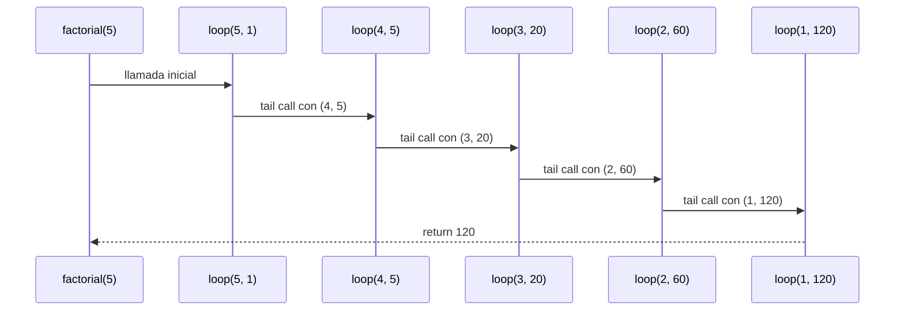
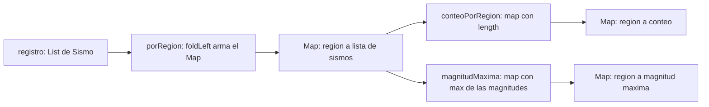
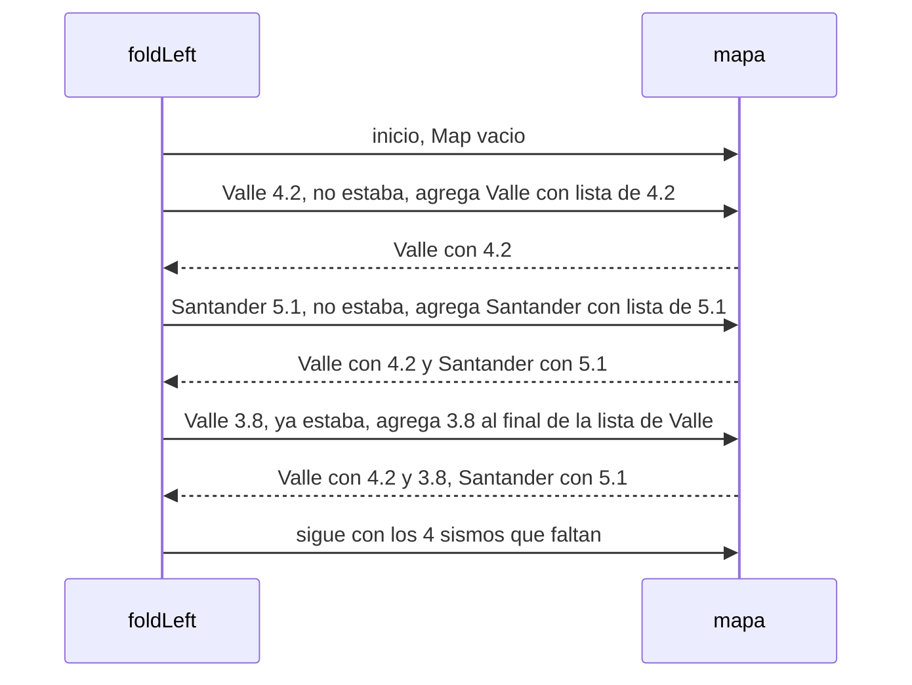
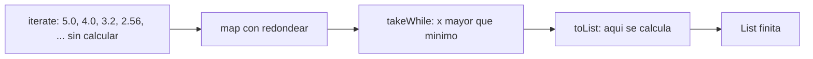
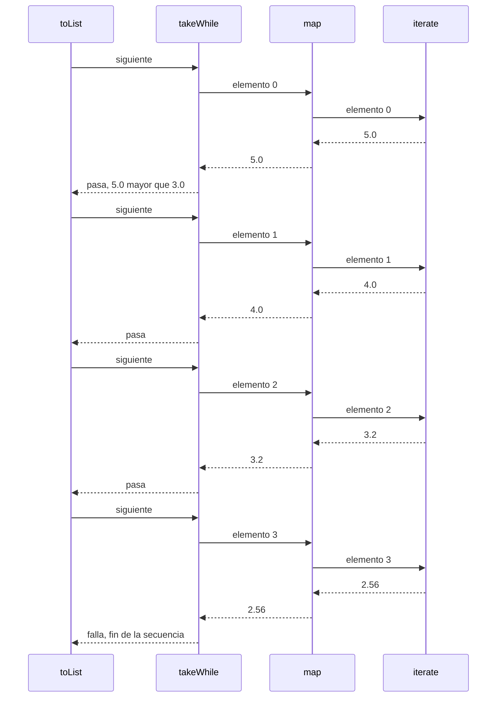
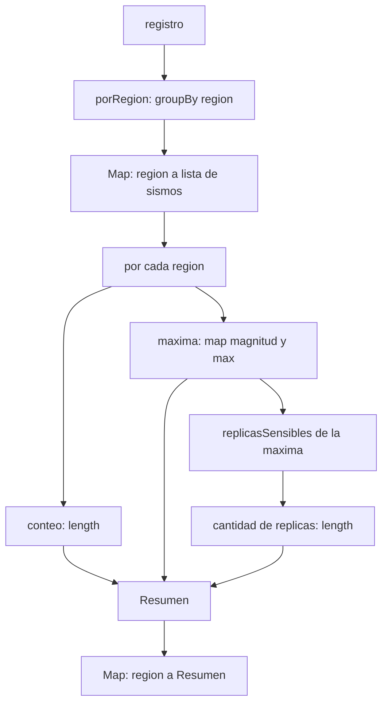
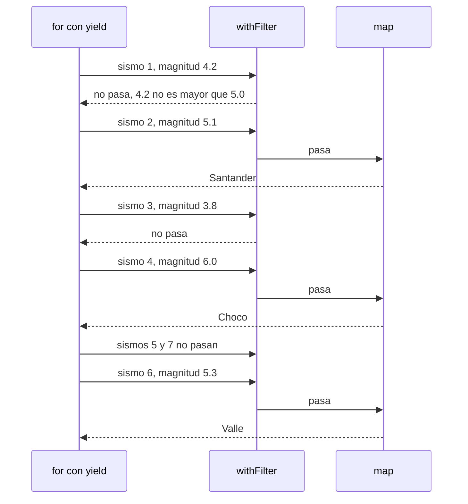
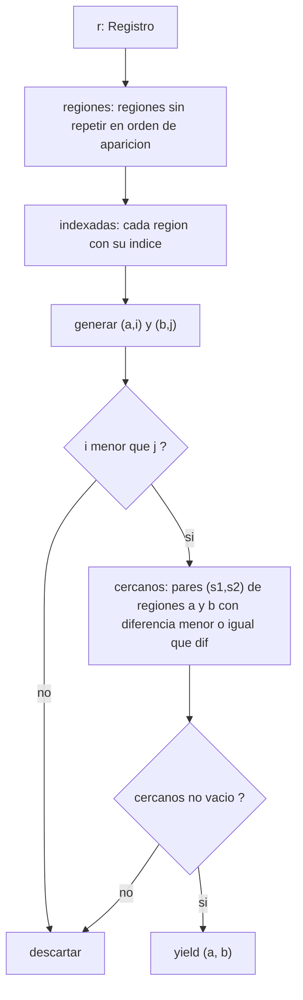

# Algoritmo Factorial con Recursión de Cola

## Definición del Algoritmo

```Scala
def factorial(n: Int): BigInt = {
  @annotation.tailrec
  def loop(x: Int, acumulador: BigInt): BigInt = {
    if (x <= 1) acumulador
    else loop(x - 1, acumulador * x)
  }
  loop(n, 1)
}
```

* La función `factorial` calcula el factorial de un número `n` utilizando **recursión de cola**.
* La función interna `loop` es la que hace la recursión:

  * Recibe dos parámetros:

    * `x`: el valor actual decreciente hasta llegar a 1.
    * `acumulador`: donde se guarda el resultado parcial en cada paso.
* El decorador `@annotation.tailrec` obliga a que la función sea optimizada como recursión de cola, es decir, **no se acumulan llamados en la pila**.

## Explicación paso a paso

### Caso base

```Scala
if (x <= 1) acumulador
```

Cuando `x` llega a `1`, la función retorna directamente el valor acumulado, evitando más llamadas.

### Caso recursivo

```Scala
loop(x - 1, acumulador * x)
```

En cada llamada:

* Se reduce el valor de `x` en 1.
* Se multiplica el acumulador por `x` y se pasa a la siguiente iteración.
* Como es recursión de cola, la llamada recursiva es la **última instrucción** en ejecutarse, lo que permite a Scala optimizar la pila.

---

## Llamados de pila en recursión de cola

Ejemplo:

```Scala
factorial(5)
```

### Paso 1: Llamada inicial

```Scala
loop(5, 1)
```

### Paso 2: Primera iteración

```Scala
loop(4, 5)   // acumulador = 1 * 5
```

### Paso 3: Segunda iteración

```Scala
loop(3, 20)  // acumulador = 5 * 4
```

### Paso 4: Tercera iteración

```Scala
loop(2, 60)  // acumulador = 20 * 3
```

### Paso 5: Cuarta iteración

```Scala
loop(1, 120) // acumulador = 60 * 2
```

### Paso 6: Caso base

```Scala
return 120
```

---

## Diferencia con recursión normal

* En **recursión normal** cada llamada queda en la pila esperando a que termine la siguiente, lo que puede causar desbordamiento si `n` es muy grande.
* En **recursión de cola**, el compilador transforma el proceso en un **bucle optimizado**, por lo que no se guarda cada llamada en la pila y el algoritmo puede ejecutarse para valores muy grandes sin problema.

---

## Ejemplo de uso

```Scala
val resultado = factorial(5)
println(resultado)  // 120
```

El resultado de `factorial(5)` es `120`.


## Diagrama de llamados de pila con recursión de cola


## Punto 2: agrupar con mapas

### Código

```scala
def porRegion(r: Registro): Map[String, List[Sismo]] =
  r.foldLeft(Map[String, List[Sismo]]()) { (mapa, sismo) =>
    mapa + (sismo.region -> (mapa.getOrElse(sismo.region, List()) :+ sismo))
  }

def conteoPorRegion(r: Registro): Map[String, Int] = {
  val grupos = porRegion(r)
  grupos.map { case (region, sismos) =>
    (region, sismos.length)
  }
}

def magnitudMaxima(r: Registro): Map[String, Double] = {
  val grupos = porRegion(r)
  grupos.map { case (region, sismos) =>
    val magnitudes = sismos.map(sismo => sismo.magnitud)
    (region, magnitudes.max)
  }
}
```

### Qué hace cada operación

* Un `Map[String, List[Sismo]]` es una tabla: cada **llave** (la región) apunta a
  un **valor** (la lista de sismos de esa región).
* `r.foldLeft(inicio) { (mapa, sismo) => ... }` recorre la lista `r` de
  izquierda a derecha. Empieza con el valor `inicio` y, por cada sismo, aplica la
  función `(mapa, sismo) => ...`, que recibe lo armado hasta ahora (`mapa`) y el
  sismo que toca, y devuelve el mapa nuevo. El mapa que devuelve el último sismo
  es el resultado.
* `Map[String, List[Sismo]]()` es el `inicio`: un mapa vacío.
* `mapa.getOrElse(sismo.region, List())` pide la lista de la región del sismo.
  Si la región todavía no está en el mapa, devuelve una lista vacía.
* `:+ sismo` agrega el sismo al final de esa lista y devuelve una lista nueva.
* `mapa + (region -> lista)` devuelve un mapa nuevo con ese par. Si la región ya
  estaba, reemplaza su lista; si no, la agrega. El mapa anterior no se modifica.
* `grupos.map { case (region, sismos) => ... }` visita cada par del mapa. El
  `case (region, sismos)` le pone nombre a la llave y al valor. La función
  devuelve un par nuevo, y esos pares forman un `Map` nuevo.
* `sismos.length` es la cantidad de sismos de la lista.
* `sismos.map(sismo => sismo.magnitud)` convierte la lista de sismos en la lista
  de sus magnitudes, y `.max` toma la mayor.
* `val grupos = porRegion(r)` le pone nombre al resultado para usarlo en la
  línea siguiente. Un `val` se fija una vez y no cambia, así que no es una
  variable.

`foldLeft` reemplaza al ciclo: no hay `var`, `while` ni `return`. Lo que va
armado viaja de un paso al siguiente como el parámetro `mapa`.

### Expresiones `for`

En el punto 2 **no se usó ninguna expresión `for`**: los agrupamientos se hacen
con mapas (`foldLeft` y `map`). Si `conteoPorRegion` se escribiera con `for`,
sería:

```scala
for ((region, sismos) <- porRegion(r)) yield (region, sismos.length)
```

y el compilador lo traduce a `porRegion(r).map { case (region, sismos) => (region, sismos.length) }`,
que es la versión entregada.

### Ejecución paso a paso: `porRegion(registro)`

Se empieza con `Map()`. En cada paso se procesa un sismo y se crea un mapa nuevo
(para abreviar, las listas muestran solo las magnitudes).

| Paso | Sismo que se procesa | ¿La región ya estaba? | Mapa después del paso |
|:---:|---|:---:|---|
| 0 | (inicio) | | `Map()` |
| 1 | Valle, 4.2 | No | Valle → (4.2) |
| 2 | Santander, 5.1 | No | Valle → (4.2), Santander → (5.1) |
| 3 | Valle, 3.8 | Sí | Valle → (4.2, 3.8), Santander → (5.1) |
| 4 | Choco, 6.0 | No | Valle → (4.2, 3.8), Santander → (5.1), Choco → (6.0) |
| 5 | Santander, 4.7 | Sí | Valle → (4.2, 3.8), Santander → (5.1, 4.7), Choco → (6.0) |
| 6 | Valle, 5.3 | Sí | Valle → (4.2, 3.8, 5.3), Santander → (5.1, 4.7), Choco → (6.0) |
| 7 | Choco, 3.1 | Sí | Valle → (4.2, 3.8, 5.3), Santander → (5.1, 4.7), Choco → (6.0, 3.1) |

Al terminar la lista, el resultado es el mapa del paso 7. Cada región conserva
sus sismos en el orden en que aparecen en el registro.

### Ejecución paso a paso: `conteoPorRegion(registro)`

1. `porRegion(registro)` da el mapa del paso 7 y se guarda en `grupos`.
2. `map` visita cada par y cambia la lista por su tamaño:

   | Par que entra | `sismos.length` | Par que sale |
   |---|:---:|---|
   | Valle → (4.2, 3.8, 5.3) | 3 | (Valle, 3) |
   | Santander → (5.1, 4.7) | 2 | (Santander, 2) |
   | Choco → (6.0, 3.1) | 2 | (Choco, 2) |

3. Los pares se reúnen en un mapa:
   `Map("Valle" -> 3, "Santander" -> 2, "Choco" -> 2)`.

### Ejecución paso a paso: `magnitudMaxima(registro)`

1. `porRegion(registro)` da el mapa del paso 7 y se guarda en `grupos`.
2. `map` visita cada par. Primero saca las magnitudes y luego toma la mayor:

   | Región | `magnitudes` | `magnitudes.max` | Par que sale |
   |---|---|:---:|---|
   | Valle | List(4.2, 3.8, 5.3) | 5.3 | (Valle, 5.3) |
   | Santander | List(5.1, 4.7) | 5.1 | (Santander, 5.1) |
   | Choco | List(6.0, 3.1) | 6.0 | (Choco, 6.0) |

3. Los pares se reúnen en un mapa:
   `Map("Valle" -> 5.3, "Santander" -> 5.1, "Choco" -> 6.0)`.

### Casos borde

* **Registro vacío.** `foldLeft` no tiene sismos que procesar y devuelve el
  `inicio`, `Map()`. Entonces `grupos` es `Map()`, el `map` no tiene pares que
  visitar y `conteoPorRegion` y `magnitudMaxima` también dan `Map()`.
* **Región que no está en el registro.** Una región solo entra al mapa cuando se
  procesa un sismo suyo, así que una región ausente no aparece.
* **Un solo sismo.** El mapa queda con una sola región. Su lista tiene un sismo,
  su conteo es 1 y su máxima es la magnitud de ese sismo.
* **`max` sobre una lista vacía.** Nunca ocurre: una región solo existe si tiene
  al menos un sismo, así que cada lista tiene por lo menos un elemento.
* **Orden.** Si el registro se recorre al revés, el conteo y la magnitud máxima
  son los mismos. Solo cambia el orden de los sismos dentro de cada lista de
  `porRegion` (ver `correccion.md`, sección 2.6). Además, el orden en que se
  muestran las regiones dentro del `Map` no es parte del resultado.

### Diagramas

Cómo se relacionan las tres funciones:



Los primeros pasos de `foldLeft` en `porRegion(registro)`:



---
## Punto 4: réplicas perezosas
### Código

```scala
def replicas(magnitud: Double): LazyList[Double] = {
  def redondear(x: Double): Double = Math.round(x * 100.0) / 100.0
  LazyList.iterate(magnitud)(_ * 0.8).map(redondear)
}

def replicasSensibles(magnitud: Double, minimo: Double): List[Double] = {
  replicas(magnitud).takeWhile(_ > minimo).toList
}
```

### Qué hace cada operación

* `LazyList.iterate(magnitud)(_ * 0.8)` produce la secuencia infinita
  `magnitud, magnitud * 0.8, magnitud * 0.8 * 0.8, ...`. Es **perezosa**: guarda
  el primer valor y una "receta" para calcular el resto, pero no lo calcula.
* `.map(redondear)` redondea a dos decimales. En un `LazyList`, `map`
  también es perezoso: no recorre nada, solo anota que cada elemento, cuando
  se pida, debe pasar por `redondear`.
* `.takeWhile(_ > minimo)` entrega los elementos desde el principio y se
  detiene en el primero que **no** supera el mínimo. No mira ninguno después.
* `.toList` es lo que obliga a calcular. Recorre lo que `takeWhile` deja pasar
  y lo guarda en una lista normal, que ya es finita.
* `.take(4)` (en las pruebas) entrega los primeros cuatro elementos.

El redondeo se hace **después** de `iterate`, no dentro. Así cada valor sale de
multiplicar la magnitud original por $0.8^k$ y se redondea una sola vez; si se
redondeara en cada paso, el error se acumularía de réplica en réplica.

### Expresiones `for`

En los puntos 4 y 5 **no se usó ninguna expresión `for`**: la secuencia se
construye con `iterate`, `map` y `takeWhile`, que ya describen el _qué_ sin
recorrer nada a mano. No hay ciclos, `var`, `while` ni `return`.

### Ejecución paso a paso: `replicas(5.0).take(4).toList`

Los valores "crudos" son los que produce `iterate`; los "redondeados" son los
que salen de `map`.

| Posición $k$ | Valor crudo | Valor redondeado | ¿Se calcula? |
|:---:|:---:|:---:|:---|
| 0 | 5.0 | 5.0 | Sí |
| 1 | 4.0 | 4.0 | Sí |
| 2 | 3.2 | 3.2 | Sí |
| 3 | 2.5600000000000005 | 2.56 | Sí |
| 4 | 2.048... | 2.05 | **No**, `take(4)` ya no lo pide |
| 5, 6, ... | ... | ... | **No** |

Resultado: `List(5.0, 4.0, 3.2, 2.56)`. Se calculan exactamente cuatro
elementos, aunque la secuencia no termine nunca.

### Ejecución paso a paso: `replicasSensibles(5.0, 3.0)`

1. `replicas(5.0)` crea la secuencia, sin calcular ningún elemento.
2. `takeWhile(_ > 3.0)` se arma, todavía sin calcular nada.
3. `toList` pide el primer elemento: se calcula `5.0`. Como $5.0 > 3.0$, pasa.
4. Pide el segundo: `4.0`. Como $4.0 > 3.0$, pasa.
5. Pide el tercero: `3.2`. Como $3.2 > 3.0$, pasa.
6. Pide el cuarto: `2.56`. Como $2.56 > 3.0$ es falso, `takeWhile` **se detiene**.
   El quinto elemento nunca se calcula.
7. `toList` entrega `List(5.0, 4.0, 3.2)`.

Caso borde, `replicasSensibles(2.0, 3.0)`: el primer elemento es `2.0`, no
supera `3.0`, `takeWhile` se detiene de inmediato y el resultado es `List()`.
Solo se calculó un elemento.

### Por qué la secuencia infinita no agota la memoria

Una secuencia infinita **no cabe** en memoria si se construye completa; esta
nunca se construye completa. Hay tres razones:

1. **Cada elemento se calcula solo cuando alguien lo pide.** Un `LazyList` es
   una celda con la cabeza ya calculada y la cola como un cálculo pendiente.
   Mientras nadie pida la cola, ocupa una cantidad fija de memoria.
2. **`takeWhile` deja de pedir elementos apenas falla la condición.** Si hay
   $n$ réplicas sensibles, se calculan $n + 1$ elementos: los $n$ que pasan y
   el primero que falla. El resto de la secuencia, infinito, nunca existe. Con
   `take(4)` se calculan exactamente 4.
3. **`replicasSensibles` no guarda la secuencia.** `replicas(magnitud)` es una
   expresión intermedia que nadie conserva en una `val`; cuando `toList`
   termina, el resultado es una `List` finita de $n$ elementos y las celdas
   intermedias quedan libres para el recolector de basura. La memoria usada es
   proporcional a $n$, no al largo de la secuencia.

Una `List` normal no podría hacer esto: pedir "la lista infinita" calcularía
elementos para siempre y se agotaría la memoria. Por la misma razón, **nunca**
se debe llamar a `toList`, `size` o `foreach` sobre `replicas(m)` sin antes
limitarla con `take` o `takeWhile`.

### Diagramas

Cadena de transformaciones (nada se calcula hasta `toList`):



Orden en que se piden los elementos en `replicasSensibles(5.0, 3.0)`:



---

## Punto 5: informe combinado
### Código

```scala
def informe(r: Registro, minimo: Double): Map[String, Resumen] = {
  porRegion(r).map { case (region, sismos) =>
    val maxima = sismos.map(_.magnitud).max
    region -> Resumen(sismos.length, maxima, replicasSensibles(maxima, minimo).length)
  }
}
```

`informe` no calcula nada por su cuenta: combina `porRegion` (punto 2) para
agrupar y `replicasSensibles` (punto 4) para contar las réplicas.

### Qué hace cada parte

* `porRegion(r)` es `r.groupBy(sismo => sismo.region)`: un
  `Map[String, List[Sismo]]` con una entrada por cada región que aparece en el
  registro.
* `.map { case (region, sismos) => ... }` visita cada entrada del mapa. El
  `case (region, sismos)` separa la llave del valor.
* `sismos.length` es el conteo de sismos de la región.
* `sismos.map(_.magnitud).max` es la magnitud máxima. Nunca falla por lista
  vacía, porque `groupBy` solo crea una región si tiene al menos un sismo.
* `replicasSensibles(maxima, minimo).length` cuenta las réplicas sensibles del
  sismo más fuerte de la región.
* `region -> Resumen(...)` crea el par `(region, Resumen(...))`. Un `map` sobre
  un `Map` que devuelve pares produce otro `Map`.

### Expresiones `for`

No se usó `for`. Si se escribiera con `for`, sería:

```scala
for ((region, sismos) <- porRegion(r)) yield {
  val maxima = sismos.map(_.magnitud).max
  region -> Resumen(sismos.length, maxima, replicasSensibles(maxima, minimo).length)
}
```

y el compilador lo traduce a `porRegion(r).map { case (region, sismos) => ... }`,
que es justo la versión que se entregó (con un generador y `yield` solo
aparece `map`; el patrón de tupla puede añadir un `withFilter` que deja pasar
todo).

### Ejecución paso a paso: `informe(registro, 3.0)`

1. `porRegion(registro)` agrupa los siete sismos:

   | Región | Sismos (magnitudes) |
      |---|---|
   | Valle | 4.2, 3.8, 5.3 |
   | Santander | 5.1, 4.7 |
   | Choco | 6.0, 3.1 |

2. Para cada región se calcula el resumen:

   | Región | Conteo | Máxima | Réplicas de la máxima (mayores que 3.0) | Cantidad |
      |---|:---:|:---:|---|:---:|
   | Valle | 3 | 5.3 | 5.3, 4.24, 3.39 (la siguiente, 2.71, no pasa) | 3 |
   | Santander | 2 | 5.1 | 5.1, 4.08, 3.26 (la siguiente, 2.61, no pasa) | 3 |
   | Choco | 2 | 6.0 | 6.0, 4.8, 3.84, 3.07 (la siguiente, 2.46, no pasa) | 4 |

3. Se arman los pares y el `map` los reúne en un solo mapa:
   `Map("Valle" -> Resumen(3, 5.3, 3), "Santander" -> Resumen(2, 5.1, 3), "Choco" -> Resumen(2, 6.0, 4))`.

Caso borde, `informe(List(), 3.0)`: `groupBy` sobre una lista vacía da un mapa
vacío, el `map` no tiene entradas que visitar, y el resultado es `Map()`.

Observación: el orden en que se muestran las regiones dentro del `Map` no es
parte del resultado. Dos mapas con las mismas llaves y los mismos valores son
iguales sin importar cómo se impriman.

### Diagrama


# Informe de proceso

Fundamentos de Programación Funcional y Concurrente.
Taller 3: consultas sobre un registro sísmico.

## Punto 1: consultas con expresiones for

### Código

```scala
def fuertes(r: Registro, umbral: Double): List[String] =
  for {
    s <- r
    if s.magnitud > umbral
  } yield s.region

def enRegion(r: Registro, region: String): List[Double] =
  for {
    s <- r
    if s.region == region
  } yield s.magnitud

def paresCercanos(r: Registro, dif: Double): List[(String, String)] = {
  val regiones = (for (s <- r) yield s.region).distinct
  val indexadas = regiones.zipWithIndex

  for {
    (a, i) <- indexadas
    (b, j) <- indexadas
    if i < j
    cercanos = for {
      s1 <- r if s1.region == a
      s2 <- r if s2.region == b
      if Math.abs(s1.magnitud - s2.magnitud) <= dif
    } yield (s1, s2)
    if cercanos.nonEmpty
  } yield (a, b)
}
```

Las tres consultas son expresiones `for` con `yield`. No hay `var`, `while` ni `return`, y las funciones auxiliares (`regiones`, `indexadas`, `cercanos`) viven dentro de `paresCercanos`.

### Qué hace cada función

* `fuertes` recorre el registro, descarta los sismos cuya magnitud no supera el umbral y devuelve la región de los que quedan. No se quitan repetidos, así que una región con dos sismos fuertes aparece dos veces, en el orden del registro.
* `enRegion` recorre el registro, se queda con los sismos de la región pedida y devuelve sus magnitudes. Si la región no está, ningún sismo pasa la guardia y el resultado es `List()`.
* `paresCercanos` hace cuatro cosas:
    * Calcula las regiones sin repetir, en orden de primera aparición (`regiones`).
    * Les pone un índice con `zipWithIndex`.
    * Forma todas las combinaciones de dos regiones y se queda solo con las que cumplen `i < j`. Así una región nunca se empareja consigo misma y cada pareja sale una sola vez.
    * Deja pasar la pareja solo si existe algún par de sismos, uno de cada región, con magnitudes que difieren a lo sumo `dif`. Eso lo decide el `for` interno (`cercanos`).

### Expresiones `for`: en qué se traducen

El compilador traduce todo `for` a `map`, `flatMap` y `withFilter` con estas reglas:

* Un generador con `yield`: `for (x <- c) yield e` se traduce a `c.map(x => e)`.
* Un generador con guardia: `for (x <- c if p) yield e` se traduce a `c.withFilter(x => p).map(x => e)`.
* Varios generadores: todos menos el último se traducen a `flatMap`, y el último a `map`.

**`fuertes`**

```scala
r.withFilter(s => s.magnitud > umbral).map(s => s.region)
```

**`enRegion`**

```scala
r.withFilter(s => s.region == region).map(s => s.magnitud)
```

**`paresCercanos`, regiones sin repetir**

```scala
r.map(s => s.region).distinct
```

**`paresCercanos`, el `for` interno (`cercanos`)**

```scala
r.withFilter(s1 => s1.region == a).flatMap(s1 =>
  r.withFilter(s2 => s2.region == b)
   .withFilter(s2 => Math.abs(s1.magnitud - s2.magnitud) <= dif)
   .map(s2 => (s1, s2)))
```

**`paresCercanos`, el `for` externo**

Tiene dos generadores, una guardia, una definición (`cercanos = ...`) y otra guardia. Es equivalente a:

```scala
indexadas.flatMap { case (a, i) =>
  indexadas
    .withFilter { case (b, j) => i < j }
    .map { case (b, j) =>
      val cercanos = /* el for interno */
      (b, cercanos)
    }
    .withFilter { case (b, cercanos) => cercanos.nonEmpty }
    .map { case (b, _) => (a, b) }
}
```

La definición `cercanos = ...` se convierte en un `val` dentro de un `map`, y la guardia siguiente filtra sobre ese valor. El patrón de tupla `(a, i) <- indexadas` puede añadir un `withFilter` que deja pasar todo, porque toda tupla cumple el patrón.

### Ejecución paso a paso: `fuertes(registro, 5.0)`

| Posición | Sismo | Magnitud | ¿Mayor que 5.0? | Aporta |
|:---:|---|:---:|:---:|---|
| 1 | Valle | 4.2 | No | — |
| 2 | Santander | 5.1 | Sí | "Santander" |
| 3 | Valle | 3.8 | No | — |
| 4 | Choco | 6.0 | Sí | "Choco" |
| 5 | Santander | 4.7 | No | — |
| 6 | Valle | 5.3 | Sí | "Valle" |
| 7 | Choco | 3.1 | No | — |

Resultado: `List("Santander", "Choco", "Valle")`.

Con umbral `6.0` el sismo de Choco (magnitud exacta 6.0) no entra, porque la comparación es estricta. Con umbral `9.0` ningún sismo pasa y el resultado es `List()`.

### Ejecución paso a paso: `enRegion(registro, "Valle")`

| Posición | Región | ¿Es "Valle"? | Aporta |
|:---:|---|:---:|:---:|
| 1 | Valle | Sí | 4.2 |
| 2 | Santander | No | — |
| 3 | Valle | Sí | 3.8 |
| 4 | Choco | No | — |
| 5 | Santander | No | — |
| 6 | Valle | Sí | 5.3 |
| 7 | Choco | No | — |

Resultado: `List(4.2, 3.8, 5.3)`.

Caso borde, `enRegion(registro, "Amazonas")`: ningún sismo cumple la guardia y el resultado es `List()`. Con el registro vacío tampoco hay elementos que recorrer, y el resultado es `List()`.

### Ejecución paso a paso: `paresCercanos(registro, 0.6)`

1. `regiones` es `List("Valle", "Santander", "Choco")`, en el orden en que aparece cada una por primera vez.
2. `indexadas` es `List(("Valle",0), ("Santander",1), ("Choco",2))`.
3. Los dos generadores producen las 9 combinaciones $(a, b)$. La guardia `i < j` deja solo tres:

   | Pareja | Magnitudes de $a$ | Magnitudes de $b$ | Menor diferencia | ¿Es $\le 0.6$? | ¿Sale? |
      |---|---|---|:---:|:---:|:---:|
   | (Valle, Santander) | 4.2, 3.8, 5.3 | 5.1, 4.7 | 0.2 (5.3 y 5.1) | Sí | Sí |
   | (Valle, Choco) | 4.2, 3.8, 5.3 | 6.0, 3.1 | 0.7 (5.3 y 6.0, o 3.8 y 3.1) | No | No |
   | (Santander, Choco) | 5.1, 4.7 | 6.0, 3.1 | 0.9 (5.1 y 6.0) | No | No |

Resultado: `List(("Valle", "Santander"))`.

Con `dif = 1.0` las tres parejas cumplen la condición y salen en el orden `(Valle, Santander)`, `(Valle, Choco)`, `(Santander, Choco)`. Con `dif = 0.1` ninguna cumple y el resultado es `List()`.

Caso borde: con una sola región, `indexadas` tiene un solo elemento, no existe ningún par con `i < j` y el resultado es `List()`.

### Diagramas

Orden en que `fuertes(registro, 5.0)` pide y descarta los sismos:



Flujo de `paresCercanos`:



### Observaciones

* Las tres consultas dicen **qué** se busca (sismos que pasan una guardia, parejas con una propiedad) y no **cómo** recorrer el registro.
* El orden de salida lo fija el orden del registro: `fuertes` y `enRegion` respetan el orden de los sismos, y `paresCercanos` el orden de primera aparición de las regiones.
* La comparación `Math.abs(...) <= dif` es sobre `Double`. En los ejemplos las diferencias relevantes (0.2, 0.7 y 0.9) quedan lejos de los valores de `dif` usados, así que el redondeo de punto flotante no cambia el resultado.

# Informe de proceso

Fundamentos de Programación Funcional y Concurrente.
Taller 3: consultas sobre un registro sísmico.

## Punto 1: consultas con expresiones for

### Código

```scala
def fuertes(r: Registro, umbral: Double): List[String] =
  for {
    s <- r
    if s.magnitud > umbral
  } yield s.region

def enRegion(r: Registro, region: String): List[Double] =
  for {
    s <- r
    if s.region == region
  } yield s.magnitud

def paresCercanos(r: Registro, dif: Double): List[(String, String)] = {
  val regiones = (for (s <- r) yield s.region).distinct
  val indexadas = regiones.zipWithIndex

  for {
    (a, i) <- indexadas
    (b, j) <- indexadas
    if i < j
    cercanos = for {
      s1 <- r if s1.region == a
      s2 <- r if s2.region == b
      if Math.abs(s1.magnitud - s2.magnitud) <= dif
    } yield (s1, s2)
    if cercanos.nonEmpty
  } yield (a, b)
}
```

Las tres consultas son expresiones `for` con `yield`. No hay `var`, `while` ni `return`, y las funciones auxiliares (`regiones`, `indexadas`, `cercanos`) viven dentro de `paresCercanos`.

### Qué hace cada función

* `fuertes` recorre el registro, descarta los sismos cuya magnitud no supera el umbral y devuelve la región de los que quedan. No se quitan repetidos, así que una región con dos sismos fuertes aparece dos veces, en el orden del registro.
* `enRegion` recorre el registro, se queda con los sismos de la región pedida y devuelve sus magnitudes. Si la región no está, ningún sismo pasa la guardia y el resultado es `List()`.
* `paresCercanos` hace cuatro cosas:
    * Calcula las regiones sin repetir, en orden de primera aparición (`regiones`).
    * Les pone un índice con `zipWithIndex`.
    * Forma todas las combinaciones de dos regiones y se queda solo con las que cumplen `i < j`. Así una región nunca se empareja consigo misma y cada pareja sale una sola vez.
    * Deja pasar la pareja solo si existe algún par de sismos, uno de cada región, con magnitudes que difieren a lo sumo `dif`. Eso lo decide el `for` interno (`cercanos`).

### Expresiones `for`: en qué se traducen

El compilador traduce todo `for` a `map`, `flatMap` y `withFilter` con estas reglas:

* Un generador con `yield`: `for (x <- c) yield e` se traduce a `c.map(x => e)`.
* Un generador con guardia: `for (x <- c if p) yield e` se traduce a `c.withFilter(x => p).map(x => e)`.
* Varios generadores: todos menos el último se traducen a `flatMap`, y el último a `map`.

**`fuertes`**

```scala
r.withFilter(s => s.magnitud > umbral).map(s => s.region)
```

**`enRegion`**

```scala
r.withFilter(s => s.region == region).map(s => s.magnitud)
```

**`paresCercanos`, regiones sin repetir**

```scala
r.map(s => s.region).distinct
```

**`paresCercanos`, el `for` interno (`cercanos`)**

```scala
r.withFilter(s1 => s1.region == a).flatMap(s1 =>
  r.withFilter(s2 => s2.region == b)
   .withFilter(s2 => Math.abs(s1.magnitud - s2.magnitud) <= dif)
   .map(s2 => (s1, s2)))
```

**`paresCercanos`, el `for` externo**

Tiene dos generadores, una guardia, una definición (`cercanos = ...`) y otra guardia. Es equivalente a:

```scala
indexadas.flatMap { case (a, i) =>
  indexadas
    .withFilter { case (b, j) => i < j }
    .map { case (b, j) =>
      val cercanos = /* el for interno */
      (b, cercanos)
    }
    .withFilter { case (b, cercanos) => cercanos.nonEmpty }
    .map { case (b, _) => (a, b) }
}
```

La definición `cercanos = ...` se convierte en un `val` dentro de un `map`, y la guardia siguiente filtra sobre ese valor. El patrón de tupla `(a, i) <- indexadas` puede añadir un `withFilter` que deja pasar todo, porque toda tupla cumple el patrón.

### Ejecución paso a paso: `fuertes(registro, 5.0)`

| Posición | Sismo | Magnitud | ¿Mayor que 5.0? | Aporta |
|:---:|---|:---:|:---:|---|
| 1 | Valle | 4.2 | No | — |
| 2 | Santander | 5.1 | Sí | "Santander" |
| 3 | Valle | 3.8 | No | — |
| 4 | Choco | 6.0 | Sí | "Choco" |
| 5 | Santander | 4.7 | No | — |
| 6 | Valle | 5.3 | Sí | "Valle" |
| 7 | Choco | 3.1 | No | — |

Resultado: `List("Santander", "Choco", "Valle")`.

Con umbral `6.0` el sismo de Choco (magnitud exacta 6.0) no entra, porque la comparación es estricta. Con umbral `9.0` ningún sismo pasa y el resultado es `List()`.

### Ejecución paso a paso: `enRegion(registro, "Valle")`

| Posición | Región | ¿Es "Valle"? | Aporta |
|:---:|---|:---:|:---:|
| 1 | Valle | Sí | 4.2 |
| 2 | Santander | No | — |
| 3 | Valle | Sí | 3.8 |
| 4 | Choco | No | — |
| 5 | Santander | No | — |
| 6 | Valle | Sí | 5.3 |
| 7 | Choco | No | — |

Resultado: `List(4.2, 3.8, 5.3)`.

Caso borde, `enRegion(registro, "Amazonas")`: ningún sismo cumple la guardia y el resultado es `List()`. Con el registro vacío tampoco hay elementos que recorrer, y el resultado es `List()`.

### Ejecución paso a paso: `paresCercanos(registro, 0.6)`

1. `regiones` es `List("Valle", "Santander", "Choco")`, en el orden en que aparece cada una por primera vez.
2. `indexadas` es `List(("Valle",0), ("Santander",1), ("Choco",2))`.
3. Los dos generadores producen las 9 combinaciones $(a, b)$. La guardia `i < j` deja solo tres:

   | Pareja | Magnitudes de $a$ | Magnitudes de $b$ | Menor diferencia | ¿Es $\le 0.6$? | ¿Sale? |
      |---|---|---|:---:|:---:|:---:|
   | (Valle, Santander) | 4.2, 3.8, 5.3 | 5.1, 4.7 | 0.2 (5.3 y 5.1) | Sí | Sí |
   | (Valle, Choco) | 4.2, 3.8, 5.3 | 6.0, 3.1 | 0.7 (5.3 y 6.0, o 3.8 y 3.1) | No | No |
   | (Santander, Choco) | 5.1, 4.7 | 6.0, 3.1 | 0.9 (5.1 y 6.0) | No | No |

Resultado: `List(("Valle", "Santander"))`.

Con `dif = 1.0` las tres parejas cumplen la condición y salen en el orden `(Valle, Santander)`, `(Valle, Choco)`, `(Santander, Choco)`. Con `dif = 0.1` ninguna cumple y el resultado es `List()`.

Caso borde: con una sola región, `indexadas` tiene un solo elemento, no existe ningún par con `i < j` y el resultado es `List()`.

### Diagramas

Orden en que `fuertes(registro, 5.0)` pide y descarta los sismos:


Flujo de `paresCercanos`:


